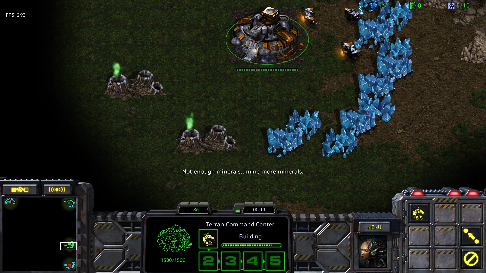
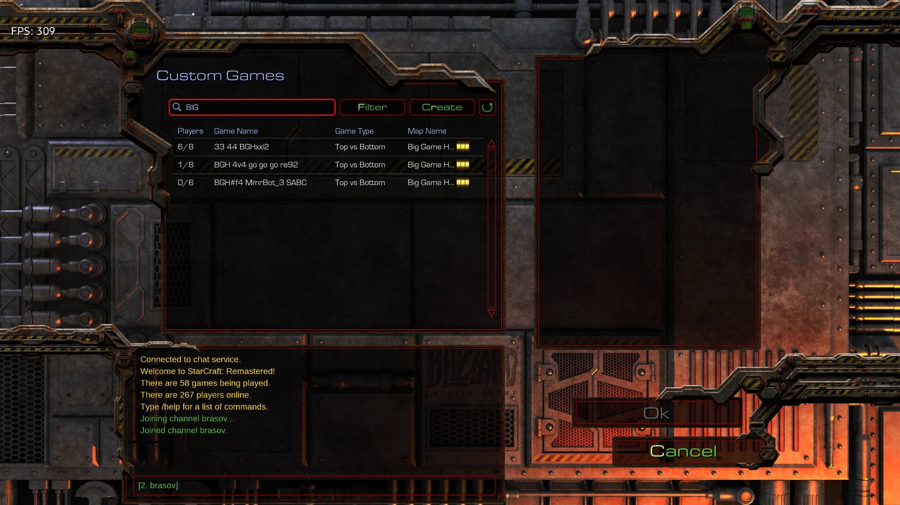

<p align="center"></p>

# StarCraft: Brood War Remastered + Battle.net on Ubuntu 26.04 (Nov 2026)

Play **StarCraft: Remastered online** on Ubuntu — no Windows, no Lutris, no system-wide changes.
Everything (Wine, DXVK, Battle.net, the game) is installed **portably into one folder**.

🇷🇴 Romanian guide: [README.ro.md](README.ro.md)

**Tested:** 2026-11-03 · Ubuntu 26.04.1 LTS · kernel 7.0 · NVIDIA GTX 1060 3GB, driver 580 · Wine TkG staging 11.21 · DXVK 3.1.1 · Battle.net 2.53.
Login works, game runs, no gameplay lag. (Online matchmaking was not stress-tested by the author.)




## Quick start (copy-paste)

```bash
# 1) one-time system prerequisites (needs sudo)
sudo dpkg --add-architecture i386
sudo apt update
sudo apt install -y curl xz-utils libvulkan1 libvulkan1:i386 mesa-vulkan-drivers \
    libgl1:i386 libgnutls30:i386 gamemode avahi-daemon libnss-mdns
# NVIDIA users: install the proprietary driver (Software & Updates > Additional Drivers)

# 2) get this repo and install (no sudo)
git clone https://github.com/rafaelKyra/starcraft-remastered-battlenet-ubuntu-26.04.git
cd starcraft-remastered-battlenet-ubuntu-26.04
./scripts/install.sh ~/starcraft-linux
```

In the Battle.net Setup window: **Install** → *decline Mono if asked* → **log in** → pick **StarCraft** → **Install** (~5 GB).

Start it later from the app menu (**Battle.net (StarCraft)**) or:

```bash
~/starcraft-linux/start-battlenet.sh
```

## Optional: less lag (needs sudo, Linux ≥ 6.14)

```bash
./scripts/enable-ntsync.sh
```

## What the script does

1. Checks CPU arch, free space (≥15 GB), Vulkan, display.
2. Downloads Wine TkG staging, DXVK, winetricks and the official Battle.net installer from their official release pages.
3. Creates an isolated Wine prefix, installs DXVK (Direct3D→Vulkan = runs on your GPU).
4. Forces Wine's X11 driver (see Troubleshooting), writes `env.sh` and `start-battlenet.sh`.
5. Adds an app-menu shortcut and launches the Battle.net installer.

## "Bonjour service"?

On Windows Battle.net installs Apple's Bonjour for local-network discovery (mDNS). On Ubuntu that role is played by **avahi-daemon** (installed above). Nothing else to do.

## Keep it stable (don't let updates break it)

- **Wine and DXVK are pinned** to the tested versions (Wine TkG 11.21, DXVK 3.1.1, sha256-verified). The script never upgrades them by itself. Newest versions: `USE_LATEST=1 ./scripts/install.sh` (untested, at your own risk).
- **Snapshot a working setup** (config + Battle.net, game excluded) and restore it if anything breaks:
  ```bash
  ./scripts/backup-prefix.sh ~/starcraft-linux
  ./scripts/restore-prefix.sh ~/starcraft-linux ~/starcraft-linux/backups/<file>.tar.zst
  ```
- **Hold the GPU driver** so a system update does not replace it (NVIDIA; undo with `apt-mark unhold`):
  ```bash
  sudo apt-mark hold $(dpkg -l | awk '/^ii +nvidia-driver-[0-9]+/{print $2}')
  ```
- **Battle.net updates itself and cannot be pinned reliably.** No supported way to freeze it is known to this guide. Check *Settings* in the app for update options, and keep a snapshot taken while it works. Blizzard server-side changes can still break login; if that happens after an update, see Troubleshooting.
- Do not upgrade Wine inside an existing prefix without a snapshot.

## Troubleshooting (real problems met while building this)

| Symptom | Cause | Fix |
|---|---|---|
| Installer window never appears, log says `no driver could be loaded` | Wine's Wayland driver fails on Ubuntu 26.04 | Already handled: `env.sh` unsets `WAYLAND_DISPLAY` and forces X11 |
| Battle.net login fails / blank | Old Wine | Use a recent Wine TkG/GE build (this script downloads the latest) |
| Changed settings have no effect | A Battle.net instance is still running with the old environment | `source ~/starcraft-linux/env.sh && wineserver -k`, then start again |
| `libgamemodeauto.so.0 cannot be preloaded` | 32-bit gamemode lib missing | Harmless; or `sudo apt install libgamemodeauto0:i386` |
| `dpkg was interrupted` | Old interrupted apt | `sudo dpkg --configure -a` |
| Want to check everything | | `./scripts/diagnose.sh ~/starcraft-linux` |

## In-game settings
Fullscreen, native resolution, Graphics Quality Ultra (even a GTX 1060 is far above what the game needs). VSync off for lowest input latency, on if you see tearing.

## Uninstall
```bash
source ~/starcraft-linux/env.sh && wineserver -k
rm -rf ~/starcraft-linux ~/.local/share/applications/battlenet-starcraft.desktop
```

## Notes
- Not affiliated with Blizzard. The script only downloads official installers; it does not ship game files. You need your own Battle.net account and game licence (StarCraft: Remastered base game is free since 2017 via the Battle.net launcher).
- Based on the approach in [andersx.dk – Blizzard app on Ubuntu](https://andersx.dk/2026/01/03/blizzard-app.html) (custom Wine fixes the login), but portable instead of Lutris.
