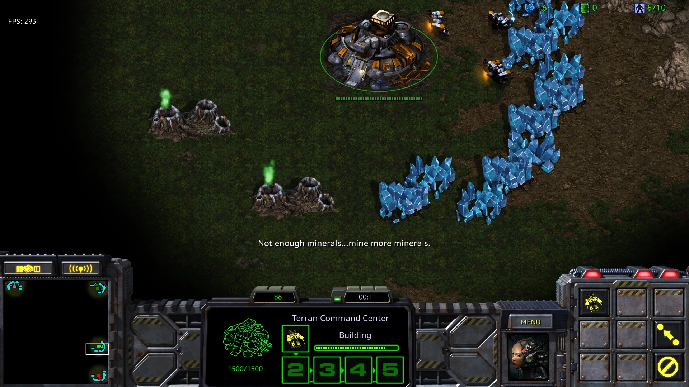
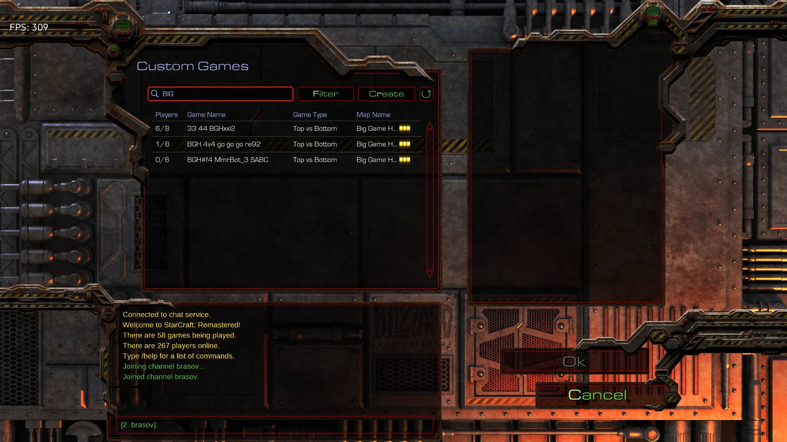

<p align="center"></p>

# StarCraft: Brood War Remastered + Battle.net pe Ubuntu 26.04 (noiembrie 2026)

Ghid „pas cu pas" pentru cei care vor să joace **StarCraft Remastered online** pe Ubuntu.
Totul se instalează **într-un singur folder**, fără Lutris și fără să strici sistemul.

**Testat:** 3 noiembrie 2026 · Ubuntu 26.04.1 · kernel 7.0 · GTX 1060 (driver 580) · Wine TkG 11.21 · DXVK 3.1.1. Login-ul și jocul merg fără lag.




## Pașii (copiezi comenzile una câte una în Terminal)

**Pasul 1 – pregătirea sistemului (o singură dată, cere parola):**
```bash
sudo dpkg --add-architecture i386
sudo apt update
sudo apt install -y git curl xz-utils libvulkan1 libvulkan1:i386 mesa-vulkan-drivers \
    libgl1:i386 libgnutls30:i386 gamemode avahi-daemon libnss-mdns
```
Dacă ai placă NVIDIA: *Software & Updates → Additional Drivers → driver proprietar* (recomandat), apoi repornește.

**Pasul 2 – descarcă ghidul și rulează instalarea (fără parolă):**
```bash
git clone https://github.com/rafaelKyra/starcraft-remastered-battlenet-ubuntu-26.04.git
cd starcraft-remastered-battlenet-ubuntu-26.04
./scripts/install.sh ~/starcraft-linux
```

**Pasul 3 – în fereastra „Battle.net Setup":** apasă *Install* → dacă întreabă de *Mono*, spune **Nu** → loghează-te → alege **StarCraft** → *Install* (~5 GB).

**Pasul 4 – de acum pornești jocul** din meniul de aplicații („Battle.net (StarCraft)") sau cu:
```bash
~/starcraft-linux/start-battlenet.sh
```

**Pasul 5 (opțional, mai puțin lag, cere parola):**
```bash
./scripts/enable-ntsync.sh
```

## „Bonjour service"?
Pe Windows, Battle.net instalează Bonjour pentru descoperirea în rețeaua locală. Pe Ubuntu rolul ăsta îl are **avahi-daemon**, instalat la Pasul 1. Nu mai ai nimic de făcut.

## Stabilitate (ca să nu strice nimic un update)

- **Wine și DXVK sunt înghețate** la versiunile testate (Wine TkG 11.21, DXVK 3.1.1, verificate sha256). Scriptul nu le actualizează singur. Ultimele versiuni: `USE_LATEST=1 ./scripts/install.sh` (netestat, pe riscul tău).
- **Fă un snapshot când merge** (setări + Battle.net, fără joc) și restaurează-l dacă se strică ceva:
  ```bash
  ./scripts/backup-prefix.sh ~/starcraft-linux
  ./scripts/restore-prefix.sh ~/starcraft-linux ~/starcraft-linux/backups/<fisier>.tar.zst
  ```
- **Blochează driverul video** ca să nu-l schimbe un update de sistem (NVIDIA; anulare cu `apt-mark unhold`):
  ```bash
  sudo apt-mark hold $(dpkg -l | awk '/^ii +nvidia-driver-[0-9]+/{print $2}')
  ```
- **Battle.net se actualizează singur și nu poate fi înghețat în mod sigur.** Ghidul nu cunoaște o metodă oficială de a-l bloca. Caută opțiuni de update în *Settings* din aplicație și păstrează un snapshot făcut cât merge. Schimbările de pe serverele Blizzard pot strica login-ul; dacă se întâmplă după un update, vezi secțiunea de depanare.
- Nu schimba versiunea de Wine într-un prefix existent fără snapshot.

## Problemă cunoscută: Battle.net pornește și se închide imediat (rezolvată)

**Simptom:** fereastra Battle.net apare o secundă și dispare; în terminal apare `free(): invalid size`; în `Errors/…/Crash.txt` scrie `0x80000003 (BREAKPOINT)` în `libcef.dll`. Și installer-ul poate crăpa la fel.

**Cauza (verificată 2026-11-05, Battle.net 2.53.8 build 17986, Wine TkG 11.21):** un mediu prea „optimizat". Setate global, aceste variabile fac clientul Battle.net (Chromium/CEF) să crape la pornire: `__GL_THREADED_OPTIMIZATIONS`, `__GL_MaxFramesAllowed`, `__GL_YIELD`, `STAGING_SHARED_MEMORY`, `WINEFSYNC/WINEESYNC/WINENTSYNC=0` și `d3d11`/`dxgi`=native (DXVK) pentru *toate* programele. Cu mediul minim, clientul a rămas pornit la 3 din 3 porniri la rece. Nu am aflat care singură variabilă e vinovată. Versiunile vechi ale ghidului puneau exact aceste variabile.

**Nu e cauza (testat):** update-ul clientului Blizzard, bibliotecile de sistem șterse (reinstalate, tot crăpa), calea cu symlink sau cu spații, discul VeraCrypt/ext, cache-ul Chromium, randarea GPU/software.

**Remediere pentru o instalare existentă:**
```bash
./scripts/fix-startup-crash.sh ~/starcraft-linux
```
Salvează `env.sh`, scrie varianta minimă și activează DXVK **doar pentru `StarCraft.exe`** (Wine `AppDefaults`), nu global. Instalările noi făcute cu `install.sh` o au deja.

**Reparat și:** `install.sh` suprascria un shortcut Battle.net existent care arăta spre altă instalare; acum îl salvează ca `.bak-…` și te anunță.

## Dacă ceva nu merge
| Problemă | Soluție |
|---|---|
| Fereastra nu apare | Scriptul forțează deja X11 (driverul Wayland din Wine pică pe 26.04) |
| Am schimbat setări și nu se văd | `source ~/starcraft-linux/env.sh && wineserver -k` și pornești din nou |
| `dpkg was interrupted` | `sudo dpkg --configure -a` |
| Vreau diagnostic | `./scripts/diagnose.sh ~/starcraft-linux` |

## Setări în joc
Fullscreen, rezoluția nativă a monitorului, Graphics Quality Ultra. VSync oprit pentru latență minimă (pornit dacă vezi „tearing").

## Dezinstalare
```bash
source ~/starcraft-linux/env.sh && wineserver -k
rm -rf ~/starcraft-linux ~/.local/share/applications/battlenet-starcraft.desktop
```

*Nu suntem afiliați cu Blizzard. Scriptul descarcă doar installere oficiale și nu conține fișiere de joc.*
